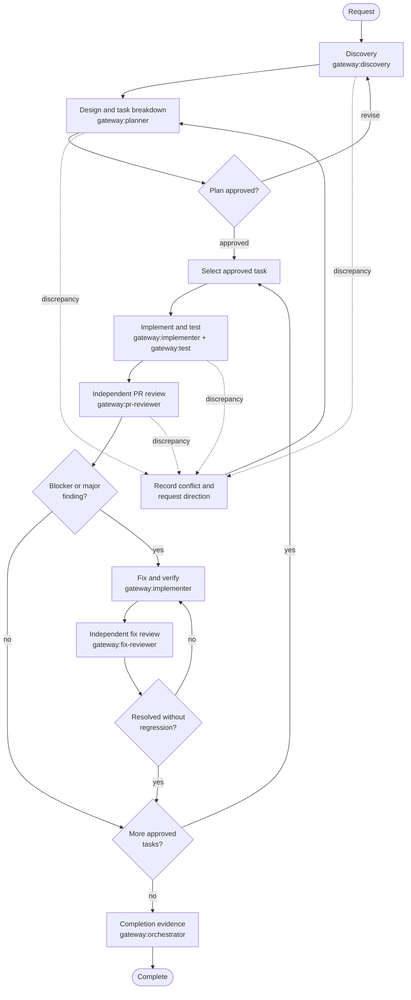

# Gateway

Gateway is a company-owned, local-first engineering workflow for Codex. It provides planning, task breakdown, implementation verification, PR review, fix review, and discrepancy handling without scripts, hooks, telemetry, update checks, or external services.

## Contents

- `skills/gateway/` — the reusable Codex skill.
- `skills/gateway/references/` — local safety and operating policy.
- `templates/` — plan, review, and discrepancy records.
- `plugin.json` — portable package metadata only; it declares no tools, hooks, integrations, or dependencies.

## Use

Install or copy `skills/gateway/` into the relevant Codex skills directory. For a repository-specific workflow, use:

```text
<project>/.codex/skills/gateway/
```

Then ask Codex to use Gateway explicitly:

```text
Use the gateway skill to plan and implement this change. Start with discovery and task breakdown, then wait for approval before code changes.
```

## Principles

- Local work by default.
- No external transmission or integration without explicit approval.
- Plans are approved before non-trivial implementation.
- Each task has observable verification evidence.
- PR review, fix, and independent fix review repeat until blocker and major findings are resolved.

## Workflow



## Evolving Gateway

Add a new skill, reference, template, script, or product integration only when a real repeated workflow needs it. Every integration must state its data flows, permissions, authentication method, outbound network behavior, owner, and approval boundary before it is added.
